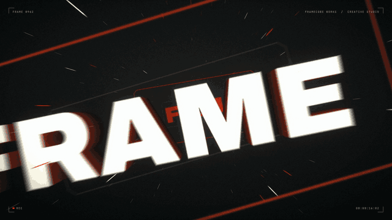
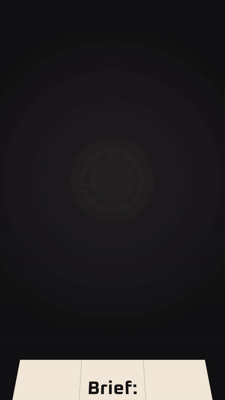

# FrameCore Works Creative Studio

Creative Studio is a plugin for ChatGPT Work, Codex and Claude that works with you on creative projects: ideas, ads, videos, motion graphics, graphics, writing, music and sound. You choose and direct; Studio plans the work with you, and where your assistant can run code it also makes the finished file.

## Watch it

The trailer (40 s). Click the preview for the full film.

From a chat to a finished reel: a client asks for a motion reel, the creator asks about the mood, and the reel plays out of its bubble.

| From a brief to a film | Vertical reel | Data and a name title |
|---|---|---|
|  |  |  |
| A note becomes a storyboard, and the storyboard becomes the ad. | A brief on paper folds into a box and unfolds into the logo. | The tallest bar of a chart becomes the owner's name title. |

All of these were made with Studio's Motion Graphics route ([how they were made](assets/demo/README.md)).

## What Studio can do

- **Graphics and advertising:** posters, flyers, banners, social posts and campaign looks.
- **Video and motion graphics:** reels, ads, animated type, explainers, storyboards and shot plans, rendered as MP4 where code can run.
- **FrameCut:** [edit your own video](docs/framecut/README.md) with captions, animation and sound in one timeline.
- **Writing:** headlines, slogans, descriptions and dialogue in your audience's language.
- **Prompts and references:** instructions for image and video generators, with references that guide the project.
- **Music, voice and sound:** music ideas, lyrics, voice-over and sound design matched to the picture.
- **Learning mode:** a simple plan, short lessons, exercises and feedback on your own work.
- **Teacher Studio:** lesson scenarios, worksheets, quizzes and games for teachers.

Studio speaks your language and starts with a short menu: creative mode, learning mode, a skill finder, recommended repositories and FrameCut. A concrete request skips the menu. Generating images, video or sound uses the tools and accounts you already have; Studio bundles no paid service.

The [full feature list](docs/features.md) describes every part in detail.

## Install

**No terminal needed.** Paste this repository's link into ChatGPT Work, Codex or Claude Code (desktop, web, cloud or phone) and ask it to install Studio and explain each step; the [prompt at the top of each guide](CLAUDE_INSTALL.md#paste-this-prompt) says it in one sentence. The assistant installs Studio, asks whether to add FrameCore Open Assets, adds FrameCore Works Toolbox and shows a numbered list of recommended tools, split into those that work right away and those that need your computer.

| Where you work | Full instructions |
|---|---|
| ChatGPT Work | [ChatGPT Work installation guide](CHATGPT_INSTALL.md) |
| Codex | [Codex installation guide](CODEX_INSTALL.md) |
| Claude Code and the Claude apps | [Claude installation guide](CLAUDE_INSTALL.md) |

Each guide also holds the step-by-step terminal procedure, checks and updates for advanced users. See also the [installation overview](INSTALL.md) and [updates](UPDATE.md).

## Companions

- [FrameCore Open Assets](https://github.com/FrameCoreWorks/framecore-open-assets): free, licence-checked photos, video, music and sound to use in your projects.
- [FrameCore Works Toolbox](https://github.com/FrameCoreWorks/framecore-works-toolbox): reviewed tools that extend Studio, with the built-in Earshot sound engine.
- Voice And Narration and Brand Kit: measured voice-overs, and a brand kit read from a website. They come from this repository's marketplace.

## For advanced users

Source version: **1.161.1**. [Release status](RELEASE_STATUS.md) · [Changelog](CHANGELOG.md) · [Full Studio documentation](plugins/framecore-work-creative-studio/README.md) · [Maintaining the repository](docs/maintaining.md) (layout, checks and packaging) · [Verification record](VERIFICATION.md)

## Licensing

FrameCore Works original code, instructions and documentation are licensed under [Apache-2.0](LICENSE). Bundled upstream sources keep their own licences and notices. See [licensing scope](LICENSE_STATUS.md) and [NOTICE](NOTICE).
