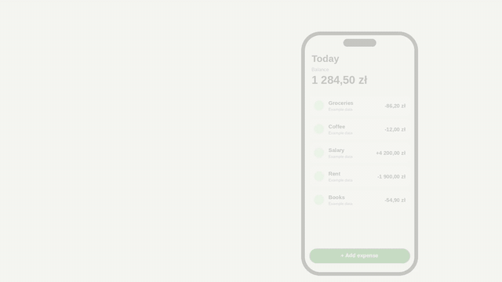
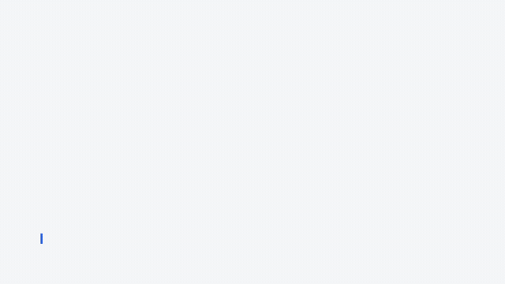

# FrameCore Works Creative Studio

[](assets/banner/creative-studio-banner.mp4)

[](https://github.com/FrameCoreWorks/framecore-works-creative-studio/actions/workflows/checks.yml)

Source version: **1.160.3**. [Repository](https://github.com/FrameCoreWorks/framecore-works-creative-studio) · [Installation](INSTALL.md) · [Release status](RELEASE_STATUS.md).

Creative Studio supports creative direction and production planning across image, video, audio and text. Brand-identity work connects strategy, logo/visual-system design and scoped logo/identity guides through existing owners, with revision-aware handoffs and explicit acceptance/file status. Work can begin with a brief, a product photo, a character reference, an existing clip, a script or a concrete correction.

## See it in 30 seconds

Studio plans the work with you and, where the host can run code, renders the result.

[](assets/demo/client-chat.mp4)

From a chat to a finished reel: a staged café client asks for a motion reel, the creator asks about the mood, and the reel plays out of its bubble. Made with Studio's Motion Graphics route as a HyperFrames composition ([how it was made](assets/demo/README.md#client-chat)).

The three clips below were rendered by Studio's own [Python renderer](plugins/framecore-work-creative-studio/skills/hyperframes-workflow/assets/motion-render/README.md) from example motion contracts in this repository, with no hand editing.

| App film from screenshots | Vertical ad with word captions | Data and name titles |
|---|---|---|
| [](assets/demo/app-film.mp4) | [](assets/demo/social-captions.mp4) | [](assets/demo/data-and-names.mp4) |
| [MP4](assets/demo/app-film.mp4) · [contract](plugins/framecore-work-creative-studio/skills/hyperframes-workflow/assets/motion-scenes/examples/app-film.motion-score.json) | [MP4](assets/demo/social-captions.mp4) · [contract](plugins/framecore-work-creative-studio/skills/hyperframes-workflow/assets/motion-scenes/examples/social-captions.motion-score.json) · [open in the player][player-social] | [MP4](assets/demo/data-and-names.mp4) · [contract](plugins/framecore-work-creative-studio/skills/hyperframes-workflow/assets/motion-scenes/examples/data-and-names.motion-score.json) · [open in the player][player-data] |

Every clip comes from one JSON contract: change a word, a colour or a timing there and the same renderer, the [motion player](https://framecoreworks.github.io/framecore-works-creative-studio/) in the browser or Remotion redraws it. How the clips were made: [assets/demo](assets/demo/README.md).

[player-social]: https://framecoreworks.github.io/framecore-works-creative-studio/#contract=eyJzY2hlbWFfdmVyc2lvbiI6MSwiaWQiOiJzb2NpYWwtY2FwdGlvbnMiLCJyZXZpc2lvbiI6MSwiYXBwcm92YWwiOnsic3RhdHVzIjoiZXhhbXBsZS1ub3QtY2xpZW50LWFwcHJvdmVkIiwicmV2aXNpb24iOm51bGwsImV2aWRlbmNlIjpudWxsfSwic3RhZ2UiOiJidWlsZCIsImdvYWwiOiJTaG93IHRoZSBhY3RpdmUtd29yZCBjYXB0aW9uIHByZXNldCBvbiBhIHZlcnRpY2FsIHNvY2lhbCB2aWRlbyIsImF1ZGllbmNlIjoiU3R1ZGlvIHVzZXJzIGFuZCBtYWludGFpbmVycyBjaGVja2luZyBjYXB0aW9ucyIsIm1lc3NhZ2UiOiJFdmVyeSBzcG9rZW4gd29yZCBsaWdodHMgdXAgYXMgaXQgaXMgc2FpZCIsImNvbmNlcHQiOiJBIHNob3J0IGhvbmV5IG9mZmVyIHJlYWQgYWxvdWQsIGNhcHRpb25zIGluIHdvcmQgYm94ZXMgYWJvdmUgdGhlIHBsYXRmb3JtIGJ1dHRvbnMiLCJydW50aW1lIjp7InN0YXR1cyI6InByb3Bvc2VkIiwidmFsdWUiOiJQeXRob24gcmVuZGVyZXIgZm9yIHRoZSBNUDQ7IHNpbmdsZS1maWxlIHByZXZpZXcgZm9yIHJldmlldyJ9LCJ2aWV3aW5nIjoiOToxNiBvbiBhIHBob25lIiwiYXVkaW8iOiJ2b2ljZS1vdmVyIChub3QgaW5jbHVkZWQgaW4gdGhlIGV4YW1wbGUpIiwiZGVjaXNpb25zIjp7ImNvbmZpcm1lZCI6WyIxMDgwIHggMTkyMCwgMzAgRlBTLCAzMDAgZnJhbWVzIiwiSWxsdXN0cmF0aXZlIGNvcHksIHByaWNlcyBhbmQgd29yZCB0aW1pbmdzIl0sInByb3Bvc2VkIjpbIlNhbGUgcG9zdGVyIHN0eWxlIHdpdGggYnVuZGxlZCBBcmNoaXZvIiwiQWN0aXZlLXdvcmQgY2FwdGlvbnMgYWJvdmUgdGhlIGJvdHRvbSAyMCAlIl0sInVua25vd24iOlsiVGhlIHJlYWwgdm9pY2Utb3ZlciBhbmQgaXRzIG1lYXN1cmVkIHdvcmQgdGltaW5ncyJdfSwiZnBzIjp7Im51bSI6MzAsImRlbiI6MX0sInRvdGFsRnJhbWVzIjozMDAsIndpZHRoIjoxMDgwLCJoZWlnaHQiOjE5MjAsInN0eWxlIjoic2FsZS1wb3N0ZXIiLCJ0b2tlbnMiOnsiYmFja2dyb3VuZCI6IiMxMDEwMTAiLCJmb3JlZ3JvdW5kIjoiI0ZGRkZGRiIsIm11dGVkIjoiI0JEQkRCRCIsImFjY2VudCI6IiNGRkQ0MDAiLCJmb250RmFtaWx5IjoiQXJjaGl2bywgQXJpYWwsIHNhbnMtc2VyaWYiLCJtYXJnaW5SYXRpbyI6MC4wNiwiY29udGVudFNjYWxlIjoxLjIsInNhZmVBcmVhIjp7InRvcCI6MC4xLCJib3R0b20iOjAuMn0sImNhcHRpb25zIjp7InByZXNldCI6ImFjdGl2ZS13b3JkIiwic2l6ZSI6NjAsIndlaWdodCI6ODAwLCJib3R0b20iOjAuMjJ9fSwiZm9udHMiOlt7ImZhbWlseSI6IkFyY2hpdm8iLCJ3ZWlnaHQiOjQwMCwiZmlsZSI6ImFyY2hpdm8vQXJjaGl2by1SZWd1bGFyLnR0ZiJ9LHsiZmFtaWx5IjoiQXJjaGl2byIsIndlaWdodCI6NzAwLCJmaWxlIjoiYXJjaGl2by9BcmNoaXZvLUJvbGQudHRmIn0seyJmYW1pbHkiOiJBcmNoaXZvIiwid2VpZ2h0Ijo4MDAsImZpbGUiOiJhcmNoaXZvL0FyY2hpdm8tQ29uZGVuc2VkRXh0cmFCb2xkLnR0ZiJ9XSwibW90aW9uIjp7InRlbXBvIjoicHVuY2h5IiwiZW50cnlGcmFtZXMiOjEwLCJleGl0RnJhbWVzIjo4LCJsaW5lU3RhZ2dlckZyYW1lcyI6MywiaXRlbVN0YWdnZXJGcmFtZXMiOjUsImVudHJ5RWFzaW5nIjoiZWFzZU91dEV4cG8iLCJleGl0RWFzaW5nIjoiZWFzZUluQ3ViaWMiLCJyZXNvbHZlRWFzaW5nIjoiZWFzZU91dEV4cG8ifSwiY29weSI6eyJob29rLTEiOiJOb3d5IHNtYWsiLCJob29rLTIiOiJqdcW8IHcgc2tsZXBpZSIsImN0YSI6IlphbcOzdyBkbyBuaWVkemllbGkiLCJjMSI6Ik1pw7NkIGxpcG93eSB6IHBhc2lla2kgdyBCZXNraWRhY2giLCJjMiI6IlRlcmF6IDM5LDkwIHrFgiB6YW1pYXN0IDQ0LDkwIHrFgiIsImMzIjoiV3lzecWCa2EgdyAyNCBoIHcgY2HFgmVqIFBvbHNjZSJ9LCJjb3B5U3RhdHVzIjoiaWxsdXN0cmF0aXZlIiwiYXNzZXRzIjpbXSwiYWNjZXB0YW5jZSI6WyJFYWNoIGNhcHRpb24gc2hvd3Mgd2hvbGUgd29yZHMgaW4gYm94ZXMgYW5kIHRoZSBzcG9rZW4gd29yZCBpcyBoaWdobGlnaHRlZCIsIkNhcHRpb25zIHN0YXkgYWJvdmUgdGhlIGJvdHRvbSAyMiAlIG9mIHRoZSBmcmFtZSIsIlRoZSBjYWxsIHRvIGFjdGlvbiBob2xkcyB0byB0aGUgbGFzdCBmcmFtZSJdLCJjYXB0aW9ucyI6W3siaWQiOiJjMSIsInN0YXJ0Ijo2LCJlbmQiOjEwMiwiY29weSI6ImMxIiwid29yZHMiOltbNiwyMV0sWzIxLDM2XSxbMzYsNTFdLFs1MSw2Nl0sWzY2LDgxXSxbODEsOTZdXX0seyJpZCI6ImMyIiwic3RhcnQiOjEwNiwiZW5kIjoxOTgsImNvcHkiOiJjMiIsIndvcmRzIjpbWzEwNiwxMjBdLFsxMjAsMTM1XSxbMTM1LDE0OV0sWzE0OSwxNjNdLFsxNjMsMTc4XSxbMTc4LDE5Ml1dfSx7ImlkIjoiYzMiLCJzdGFydCI6MjAyLCJlbmQiOjI5MiwiY29weSI6ImMzIiwid29yZHMiOltbMjAyLDIxNF0sWzIxNCwyMjZdLFsyMjYsMjM4XSxbMjM4LDI1MF0sWzI1MCwyNjJdLFsyNjIsMjc0XSxbMjc0LDI4Nl1dfV0sInNjZW5lcyI6W3siaWQiOiJob29rIiwia2luZCI6ImxpbmUtcmV2ZWFsIiwicGFyYW1zIjp7ImxpbmVzIjpbImhvb2stMSIsImhvb2stMiJdLCJzaXplcyI6WzE1MCw5Nl0sIndlaWdodHMiOls4MDAsNzAwXX0sInB1cnBvc2UiOiJTdG9wIHRoZSBzY3JvbGwiLCJzdGFydCI6MCwiZW5kIjoxNTAsImNvcHkiOlsiaG9vay0xIiwiaG9vay0yIl0sImhvbGRzIjpbWzIwLDE0MF1dLCJmb2NhbFBvaW50IjoiTm93eSBzbWFrIiwiZW50cnkiOiJMaW5lcyByaXNlIGZyb20gdGhlaXIgbWFza3MiLCJhY3Rpb24iOiJIb2xkIiwiZXhpdCI6IkZhZGUgYW5kIGxpZnQiLCJ0cmFuc2l0aW9uIjoiQ3V0IiwicGVyc2lzdGVuY2UiOiJCYWNrZ3JvdW5kIiwiYXVkaW8iOiJWb2ljZS1vdmVyIn0seyJpZCI6ImN0YSIsImtpbmQiOiJlbmQtY2FyZCIsInBhcmFtcyI6eyJ0ZXh0IjoiY3RhIiwic2l6ZSI6MTEwLCJ3ZWlnaHQiOjgwMH0sInB1cnBvc2UiOiJBc2sgZm9yIHRoZSBvcmRlciIsInN0YXJ0IjoxNDIsImVuZCI6MzAwLCJjb3B5IjpbImN0YSJdLCJob2xkcyI6W1sxODAsMzAwXV0sImZvY2FsUG9pbnQiOiJUaGUgY2FsbCB0byBhY3Rpb24iLCJlbnRyeSI6IlNjYWxlcyBpbiB3aXRoIHRoZSBydWxlIiwiYWN0aW9uIjoiSG9sZCB0byB0aGUgbGFzdCBmcmFtZSIsImV4aXQiOiJOb25lOyBzdGFibGUgZmluYWwgZnJhbWUiLCJ0cmFuc2l0aW9uIjoiTm9uZSIsInBlcnNpc3RlbmNlIjoiQmFja2dyb3VuZCIsImF1ZGlvIjoiVm9pY2Utb3ZlciJ9XX0
[player-data]: https://framecoreworks.github.io/framecore-works-creative-studio/#contract=eyJzY2hlbWFfdmVyc2lvbiI6MSwiaWQiOiJkYXRhLWFuZC1uYW1lcyIsInJldmlzaW9uIjoxLCJhcHByb3ZhbCI6eyJzdGF0dXMiOiJleGFtcGxlLW5vdC1jbGllbnQtYXBwcm92ZWQiLCJyZXZpc2lvbiI6bnVsbCwiZXZpZGVuY2UiOm51bGx9LCJzdGFnZSI6ImJ1aWxkIiwiZ29hbCI6IlNob3cgdGhlIGxvd2VyIHRoaXJkIGFuZCB0aGUgYmFyIGNoYXJ0IHNjZW5lIGtpbmRzIHdpdGggUG9saXNoIGNvcHkgYW5kIG51bWJlcnMiLCJhdWRpZW5jZSI6IlN0dWRpbyB1c2VycyBhbmQgbWFpbnRhaW5lcnMgY2hlY2tpbmcgdGhlIGNvbW1lcmNpYWwgc2NlbmUga2luZHMiLCJtZXNzYWdlIjoiQSBuYW1lZCBzcGVha2VyIGFuZCB0aHJlZSBudW1iZXJzLCByZWFkYWJsZSBhdCBhIGdsYW5jZSIsImNvbmNlcHQiOiJBIGZvdW5kZXIgaXMgaW50cm9kdWNlZCB3aXRoIGEgbG93ZXIgdGhpcmQsIGhlciBzaG9wJ3Mgc2FsZXMgY2hhbm5lbHMgZ3JvdyBhcyBiYXJzLCBhbmQgYW4gZW5kIGNhcmQgY2xvc2VzIiwicnVudGltZSI6eyJzdGF0dXMiOiJwcm9wb3NlZCIsInZhbHVlIjoiUHl0aG9uIHJlbmRlcmVyIGZvciB0aGUgTVA0OyBzaW5nbGUtZmlsZSBwcmV2aWV3IGZvciByZXZpZXcifSwidmlld2luZyI6IjE2Ojkgb24gYSBsYXB0b3A7IDk6MTYgb24gYSBwaG9uZSIsImF1ZGlvIjoiaW50ZW50aW9uYWwgc2lsZW5jZSIsImRlY2lzaW9ucyI6eyJjb25maXJtZWQiOlsiMTkyMCB4IDEwODAgYW5kIDEwODAgeCAxOTIwLCAzMCBGUFMsIDQyMCBmcmFtZXMiLCJJbGx1c3RyYXRpdmUgY29weSBhbmQgbnVtYmVycywgbm90IGNsaWVudCBkYXRhIl0sInByb3Bvc2VkIjpbIlByb2R1Y3QgbGlnaHQgc3R5bGUgd2l0aCBidW5kbGVkIEludGVyIiwiY29udGVudFNjYWxlIDEuMiBpbiB0aGUgdmVydGljYWwgZm9ybWF0Il0sInVua25vd24iOlsiUmVhbCBmaWd1cmVzIGFuZCB0aGVpciBzb3VyY2UgZm9yIGEgY2xpZW50IHByb2plY3QiXX0sImZwcyI6eyJudW0iOjMwLCJkZW4iOjF9LCJ0b3RhbEZyYW1lcyI6NDIwLCJ3aWR0aCI6MTkyMCwiaGVpZ2h0IjoxMDgwLCJzdHlsZSI6InByb2R1Y3QtbGlnaHQiLCJ0b2tlbnMiOnsiYmFja2dyb3VuZCI6IiNGNkY3RjkiLCJmb3JlZ3JvdW5kIjoiIzBGMTcyQSIsIm11dGVkIjoiIzQ3NTU2OSIsImFjY2VudCI6IiMyNTYzRUIiLCJmb250RmFtaWx5IjoiSW50ZXIsIEFyaWFsLCBzYW5zLXNlcmlmIiwibWFyZ2luUmF0aW8iOjAuMDh9LCJmb250cyI6W3siZmFtaWx5IjoiSW50ZXIiLCJ3ZWlnaHQiOjQwMCwiZmlsZSI6ImludGVyL0ludGVyLVJlZ3VsYXIudHRmIn0seyJmYW1pbHkiOiJJbnRlciIsIndlaWdodCI6NjAwLCJmaWxlIjoiaW50ZXIvSW50ZXItU2VtaUJvbGQudHRmIn0seyJmYW1pbHkiOiJJbnRlciIsIndlaWdodCI6NzAwLCJmaWxlIjoiaW50ZXIvSW50ZXItQm9sZC50dGYifSx7ImZhbWlseSI6IkludGVyIiwid2VpZ2h0Ijo5MDAsImZpbGUiOiJpbnRlci9JbnRlci1CbGFjay50dGYifV0sIm1vdGlvbiI6eyJ0ZW1wbyI6ImNyaXNwIiwiZW50cnlGcmFtZXMiOjEyLCJleGl0RnJhbWVzIjo5LCJsaW5lU3RhZ2dlckZyYW1lcyI6NCwiaXRlbVN0YWdnZXJGcmFtZXMiOjgsImVudHJ5RWFzaW5nIjoiZWFzZU91dFF1YXJ0IiwiZXhpdEVhc2luZyI6ImVhc2VJbkN1YmljIiwicmVzb2x2ZUVhc2luZyI6ImVhc2VPdXRFeHBvIn0sImZvcm1hdHMiOlt7ImlkIjoiOXgxNiIsIndpZHRoIjoxMDgwLCJoZWlnaHQiOjE5MjAsInZpZXdpbmciOiI5OjE2IG9uIGEgcGhvbmUiLCJ0b2tlbnMiOnsiY29udGVudFNjYWxlIjoxLjIsInNhZmVBcmVhIjp7InRvcCI6MC4xLCJib3R0b20iOjAuMn19fV0sImNvcHkiOnsibmFtZSI6IkFubmEgS293YWxza2EiLCJ0aXRsZSI6IlphxYJvxbx5Y2llbGthLCBQcmFjb3duaWEgTGlwYSIsImJhci1vbmxpbmUiOiJTa2xlcCBpbnRlcm5ldG93eSIsImJhci1zaG9wIjoiU2tsZXAgc3RhY2pvbmFybnkiLCJiYXItdHJhZGUiOiJIdXJ0IiwiZW5kIjoiUHJhY293bmlhIExpcGEifSwiY29weVN0YXR1cyI6ImlsbHVzdHJhdGl2ZSIsImFzc2V0cyI6W10sImFjY2VwdGFuY2UiOlsiVGhlIG5hbWUgYW5kIHRpdGxlIGFyZSBmdWxseSByZWFkYWJsZSBmcm9tIGZyYW1lIDI4IHVudGlsIHRoZSBleGl0IiwiRWFjaCBiYXIgcmVhY2hlcyBpdHMgdmFsdWUgYW5kIHRoZSB2YWx1ZXMgbmV2ZXIgbGVhdmUgdGhlIGZyYW1lIiwiVGhlIGVuZCBjYXJkIGlzIHN0YWJsZSBmcm9tIGZyYW1lIDM1MCB0byB0aGUgbGFzdCBmcmFtZSJdLCJzY2VuZXMiOlt7ImlkIjoic3BlYWtlciIsImtpbmQiOiJsb3dlci10aGlyZCIsInBhcmFtcyI6eyJuYW1lIjoibmFtZSIsInRpdGxlIjoidGl0bGUifSwicHVycG9zZSI6IkludHJvZHVjZSB0aGUgc3BlYWtlciIsInN0YXJ0IjowLCJlbmQiOjE1MCwiY29weSI6WyJuYW1lIiwidGl0bGUiXSwiaG9sZHMiOltbMjgsMTQyXV0sImZvY2FsUG9pbnQiOiJUaGUgbmFtZSIsImVudHJ5IjoiVGhlIGFjY2VudCBiYXIgcmlzZXMsIHRoZSBuYW1lIGFuZCB0aXRsZSBzbGlkZSB1cCBmcm9tIHRoZWlyIG1hc2tzIiwiYWN0aW9uIjoiSG9sZCIsImV4aXQiOiJGYWRlIGFuZCBsaWZ0IiwidHJhbnNpdGlvbiI6IkN1dCB0byB0aGUgY2hhcnQiLCJwZXJzaXN0ZW5jZSI6IkJhY2tncm91bmQiLCJhdWRpbyI6IlNpbGVuY2UifSx7ImlkIjoiY2hhbm5lbHMiLCJraW5kIjoiYmFyLWNoYXJ0IiwicGFyYW1zIjp7ImJhcnMiOlt7ImxhYmVsIjoiYmFyLW9ubGluZSIsInZhbHVlIjoxMjQwfSx7ImxhYmVsIjoiYmFyLXNob3AiLCJ2YWx1ZSI6ODYwfSx7ImxhYmVsIjoiYmFyLXRyYWRlIiwidmFsdWUiOjQxMH1dLCJsb2NhbGUiOiJwbC1QTCIsInN1ZmZpeCI6IiB6xYIifSwicHVycG9zZSI6IlNob3cgc2FsZXMgYnkgY2hhbm5lbCIsInN0YXJ0IjoxNDIsImVuZCI6MzMwLCJjb3B5IjpbImJhci1vbmxpbmUiLCJiYXItc2hvcCIsImJhci10cmFkZSJdLCJob2xkcyI6W1syMTAsMzIyXV0sImZvY2FsUG9pbnQiOiJUaGUgbG9uZ2VzdCBiYXIiLCJlbnRyeSI6IlJvd3MgYXJyaXZlIGluIHR1cm47IGVhY2ggYmFyIGdyb3dzIGFuZCBpdHMgdmFsdWUgY291bnRzIHVwIiwiYWN0aW9uIjoiSG9sZCIsImV4aXQiOiJGYWRlIGFuZCBsaWZ0IiwidHJhbnNpdGlvbiI6IkN1dCB0byB0aGUgZW5kIGNhcmQiLCJwZXJzaXN0ZW5jZSI6IkJhY2tncm91bmQiLCJhdWRpbyI6IlNpbGVuY2UifSx7ImlkIjoiZW5kIiwia2luZCI6ImVuZC1jYXJkIiwicGFyYW1zIjp7InRleHQiOiJlbmQifSwicHVycG9zZSI6IkNsb3NlIG9uIHRoZSBicmFuZCIsInN0YXJ0IjozMjIsImVuZCI6NDIwLCJjb3B5IjpbImVuZCJdLCJob2xkcyI6W1szNTAsNDIwXV0sImZvY2FsUG9pbnQiOiJUaGUgbmFtZSIsImVudHJ5IjoiU2NhbGVzIGluIHdpdGggdGhlIHJ1bGUiLCJhY3Rpb24iOiJIb2xkIHRvIHRoZSBsYXN0IGZyYW1lIiwiZXhpdCI6Ik5vbmU7IHN0YWJsZSBmaW5hbCBmcmFtZSIsInRyYW5zaXRpb24iOiJOb25lIiwicGVyc2lzdGVuY2UiOiJCYWNrZ3JvdW5kIiwiYXVkaW8iOiJTaWxlbmNlIn1dfQ

## Install through ChatGPT Work, Codex or Claude

| Environment | Complete installation instructions | Result |
|---|---|---|
| ChatGPT Work | [ChatGPT Work installation guide](CHATGPT_INSTALL.md) | Your own private Studio plugin |
| Codex | [Codex installation guide](CODEX_INSTALL.md) | One native Studio entry backed by the complete local knowledge bundle |
| Claude Code and the Claude apps | [Claude installation guide](CLAUDE_INSTALL.md) | The Studio plugin from this repository's Claude marketplace |

**No terminal needed.** Paste this repository's link into ChatGPT Work, Codex or Claude Code (desktop, web, cloud or phone) and ask it to install Studio and explain each step; the [prompt at the top of each guide](CLAUDE_INSTALL.md#paste-this-prompt) says it in one sentence. The assistant installs Studio, asks whether to add FrameCore Open Assets, adds FrameCore Works Toolbox and shows a numbered list of recommended tools, split into those that work right away in a session and those that need your computer. Each guide also contains the full environment-specific procedure, capability checks, existing-installation handling and verification steps for terminal users.

The same marketplace carries the optional companions Voice And Narration and Brand Kit, and FrameCore Open Assets from its own repository ([FrameCoreWorks/framecore-open-assets](https://github.com/FrameCoreWorks/framecore-open-assets)). Earshot comes with the standalone FrameCore Works Toolbox ([FrameCoreWorks/framecore-works-toolbox](https://github.com/FrameCoreWorks/framecore-works-toolbox)). Each guide's companion sections say how to add them.

[Installation overview](INSTALL.md) · [Updates](UPDATE.md) · [Full Studio documentation](plugins/framecore-work-creative-studio/README.md).

## Learning or creation

Startup restores the complete Studio introduction and capability overview, then offers **1. Creative mode / 2. Learning mode / 3. Find a skill / 4. Recommended repositories / 5. FrameCut** in the user's automatically selected language. A creative-only choice shows the eight work areas (1–8) together with the pace **A. Quick mode / B. Expanded mode** in one message, then a relevant brief; a bare area number means Quick mode. The existing localized creation alias remains supported. Motion graphics remains in work area 8 of Creative Mode, with its HTML/SVG, GSAP, HyperFrames and Remotion descriptions and preview/export availability limits. A concrete request bypasses redundant menus, and numeric answers follow the last menu actually shown. Learning retains its personal plan, lessons, exercises, feedback and portable progress card. See [entry menus](plugins/framecore-work-creative-studio/skills/workflow-orchestrator/references/startup-and-creative-menus.md) and [learning mode and limits](plugins/framecore-work-creative-studio/docs/learning-mode.md).

## FrameCut

[FrameCut](docs/framecut/README.md), option 5, takes a video job through adaptive intake, source analysis, editing, captions, motion, sound, revisions and final delivery. It covers highlights, full edits, visual/screen productions and motion-only work. The local Python/FFmpeg runtime uses one editable timeline; execution depends on actual host tools. See [implemented scope and test evidence](docs/framecut/build-status.md).

## What it includes

- Quick mode: concise creative directions before detailed production work.
- Deep mode: collaborative development from research and concept through references, storyboard, prompts and editing plans.
- Product and character continuity, realistic reference capture and precise reference sheets.
- Static Graphic Design Creator methods for composition, typography, exact copy and graphic design.
- Music, voice and sound planning in relation to pictures, or picture planning around existing audio.
- Motion graphics from code: kinetic type, animated titles and logos, explainers and app or product films from screenshots or photos, rendered as a finished MP4 where the host can run code, with sound designed and mixed for the video on request, a craft critique and an improvement round before delivery; without code execution, a contract and the [motion player](https://framecoreworks.github.io/framecore-works-creative-studio/) export the video in the browser.
- Sound and captions for your own footage where the host runs code: cuts measured from the video, designed hits on the moments you mark and a music bed, mixed with or without the video's own sound and checked for timing and loudness; captions checked against reading limits, converted between SRT and WebVTT, built from timed words and burned into the video.
- A machine-readable [capability card](plugins/framecore-work-creative-studio/skills/workflow-orchestrator/assets/capability-card.json): what Studio executes itself, what each tool needs and what it delivers when a tool is missing.
- Captions, UGC and short-form stories with dated, sourced defaults: subtitle and caption reading speeds and formats, creator-ad formats with disclosure lines for paid relationships and AI presenters (Poland, EU, US), and short-form structures with a beat budget.
- [Commercial motion](plugins/framecore-work-creative-studio/skills/hyperframes-workflow/references/commercial-motion.md): adverts decided as one argument (verified claims, a hook the film answers, a CTA that closes the shown action), proved on real key frames, and accepted in four separate verdicts; a visible-text audit checks every visible word, in Studio films and in HyperFrames or other HTML compositions.
- Installation in [Claude](CLAUDE_INSTALL.md) as a plugin from this repository's marketplace, next to ChatGPT Work and Codex, and a validated list of the tools Studio uses on each host ([tools by host](plugins/framecore-work-creative-studio/skills/workflow-orchestrator/assets/environment-check/README.md#tools-by-host)).
- The [Animate engine](plugins/framecore-work-creative-studio/skills/hyperframes-workflow/references/animate-engine.md) in the motion graphics module: illustrated procedural films in code (cut paper, crosshatch ink, riso, sketchbook, manim-style math, pixel art, isometric, or a look matched from references) with story formats, a composed score, voice or beat timing and measured review, rendered to MP4 in Codex and Claude Code ([bundled from cth9191/animate, MIT](plugins/framecore-work-creative-studio/integrations/animate/README.md)).
- A [skill finder](plugins/framecore-work-creative-studio/skills/workflow-orchestrator/references/skill-finder.md), option 3 of the welcome: describe what a skill should do and Studio points to its own matching skill; in Codex and Claude Code it also searches the open [skills.sh](https://skills.sh) catalog with its security audits and installs a skill only on explicit request ([adapted from Vercel's `find-skills`](plugins/framecore-work-creative-studio/integrations/skill-finder/README.md)).
- [Recommended repositories](plugins/framecore-work-creative-studio/skills/workflow-orchestrator/references/extensions.md#recommended-repositories-list), option 4 of the welcome: the GitHub repositories FrameCore Works recommends next to Studio (Studio's own companions, then the FrameCore Works Toolbox catalog of third-party tools), each with what it does, what Studio already bundles from it, its licence and how it is installed in the agent you are using; each one is pinned to a reviewed version and installed only on request.
- [Iso Glow](plugins/framecore-work-creative-studio/skills/hyperframes-workflow/assets/iso-glow/README.md) isometric line art that lights up, adapted for video and driven by a track's bass with [`audio_envelope.py`](plugins/framecore-work-creative-studio/skills/hyperframes-workflow/assets/motion-sync/audio_envelope.py), and [art-style and explainer motion direction](plugins/framecore-work-creative-studio/skills/hyperframes-workflow/references/art-and-explainer-motion-direction.md) with a [reference breakdown](plugins/framecore-work-creative-studio/skills/hyperframes-workflow/assets/reference-breakdown/README.md) tool, adapted from iso-glow and huashu-art-motion (both MIT).
- [AI writing patterns](plugins/framecore-work-creative-studio/skills/copy-voice/references/ai-writing-patterns.md) in English and Polish with [`ai_writing_check.py`](plugins/framecore-work-creative-studio/skills/copy-voice/scripts/ai_writing_check.py), which judges whether a draft's machine-made patterns cluster; the craft rules gain the purpose test, three liveliness dials, interface and app patterns, honest placeholders and responsive layout, with more lint rules and [`contrast_check.py`](plugins/framecore-work-creative-studio/skills/pipeline-core/assets/craft-lint/contrast_check.py); adapted from anti-slop (MIT).
- [Craft rules](plugins/framecore-work-creative-studio/skills/pipeline-core/references/craft-rules.md) for type, colour, hierarchy, interface motion, states and accessibility, with [`craft_lint.py`](plugins/framecore-work-creative-studio/skills/pipeline-core/assets/craft-lint/README.md) flagging machine-made tells in HTML, CSS and SVG; [DESIGN.md export and import](plugins/framecore-work-creative-studio/skills/pipeline-core/assets/design-md/README.md) for the brand kit; and 87 licensed, credited [prompt examples](plugins/framecore-work-creative-studio/skills/pipeline-core/assets/prompt-examples/README.md) for gpt-image-2, Seedance 2.0 and HyperFrames; adapted from Open Design (Apache-2.0).
- An [environment check](plugins/framecore-work-creative-studio/skills/workflow-orchestrator/assets/environment-check/README.md) of all 59 catalog components at first installation and every update, with installed/missing/broken/unknown evidence and a disclosed installation plan. Working compatible versions are preserved; the checker installs nothing.
- [HyperFrames](plugins/framecore-work-creative-studio/skills/hyperframes-workflow/references/hyperframes-engine.md) as an optional engine for motion graphics where a shell with Node.js, FFmpeg and Chrome exists (Codex or a local project): installed with a pinned version on request, with Studio keeping intake, approvals and review; the HeyGen catalog is used only when asked.
- Dated starting maps of [image generators](plugins/framecore-work-creative-studio/skills/research-evidence/references/image-generator-snapshot.md) (19 families, 2026-09-24) and [video generators](plugins/framecore-work-creative-studio/skills/research-evidence/references/video-generator-snapshot.md) (12 families, 2026-10-09), each fact labelled by how it was confirmed; the exact target is rechecked before a model-specific prompt.
- Answers shaped for ChatGPT's interactive elements where the host offers them (choices, comparisons, timelines), always with an equivalent text path.
- Asset records, revisions, scoped preferences and portable handoffs between environments.
- Consistent skill display names, with a [standard for future additions](plugins/framecore-work-creative-studio/docs/skill-naming.md).
- 37 canonical skill entrypoints: 35 specialist routes, the orchestrator and a retained audio compatibility alias.

The package supplies instructions, knowledge, templates and local verification helpers. Generation, media inspection and editing require the user's available tools and authorization. No credentials, paid-provider account, persistent memory service or automatic cross-environment synchronization is bundled.

## Teacher Studio

Create original lesson scenarios, worksheets, games, quizzes, slide content, classroom guidance, career-exploration activities and teacher documents through existing owners. The profile includes a twelve-activity bank, three complete Polish teaching examples with keys and adaptations, and reusable pack/administration templates. It aligns objectives, student work and feedback while separating factual evidence, synthetic examples and unverified curriculum claims.

Creating school materials uses creation mode; learning how to create them remains optional Learning Mode. Actual documents, slides and graphics depend on available tools and require their own output checks. The examples are not classroom-tested or curriculum-certified. See [the teacher workflow](plugins/framecore-work-creative-studio/skills/workflow-orchestrator/references/teacher-workflow.md).

## Ad evidence and creative feedback

For social-ad work, choose a persuasive structure from supported proof, record observed competitor mechanisms separately from performance guesses, and connect supplied campaign results to the next bounded brief. An optional experiment card binds baseline/variant asset revisions, fixed conditions and actual evidence. These methods use existing owners and do not access ad accounts, publish campaigns or spend budget.

See [the ad analysis method](plugins/framecore-work-creative-studio/skills/ecommerce-campaign-strategy-director/references/ad-creative-analysis.md) and [the attributed adaptation](plugins/framecore-work-creative-studio/integrations/meta-ads-designer/README.md).

## Code-based motion graphics

The optional [motion toolkit](plugins/framecore-work-creative-studio/skills/hyperframes-workflow/references/motion-toolkit-routing.md) adds Three.js/R3F through Remotion, PixiJS effects, D3 data geometry, Mediabunny Canvas export, Lottie JSON playback and an existing-local-Manim clip bridge. Original examples include exact dependency pins and lockfiles, frame-seeking checks and explicit host/export boundaries. Install dependencies only inside an authorized project copy.

Use the existing HyperFrames/HTML/SVG or Remotion path for an approved storyboard, frame-driven implementation, actual-output review and delivery. The workflow includes a versioned motion/Style Lock contract, three stage prompts, source-bound asset/copy locks, a dependency-free synthetic frame starter and separate preview, temporal/audio and encoded-export evidence. Local execution depends on the available host tools.

[Motion craft](plugins/framecore-work-creative-studio/skills/hyperframes-workflow/references/motion-craft.md) gives concrete easing presets, frame durations, staggers, reading holds, beat grids and transition choices. Two runtime starters, a [Remotion kinetic type starter](plugins/framecore-work-creative-studio/skills/remotion-video-production/assets/kinetic-type-starter/README.md) and a [GSAP motion starter](plugins/framecore-work-creative-studio/skills/hyperframes-workflow/assets/gsap-motion-starter/README.md), read the same motion-score contract. Without a shell or renderer, a self-contained [single-file preview](plugins/framecore-work-creative-studio/skills/hyperframes-workflow/assets/single-file-preview/README.md) lets the user watch the motion in any browser. One [motion contract JSON](plugins/framecore-work-creative-studio/skills/hyperframes-workflow/references/motion-contract-json.md) file holds the storyboard, approval state and timeline for all of them. A [brief index](plugins/framecore-work-creative-studio/skills/hyperframes-workflow/assets/motion-prompt-library/README.md#pick-by-brief) maps 19 common brief types, in Polish or English, to the most relevant prompt-library blueprints. Six declarative [scene kinds](plugins/framecore-work-creative-studio/skills/hyperframes-workflow/assets/motion-scenes/README.md) let the contract alone drive the preview and the Remotion render. An [automated frame review](plugins/framecore-work-creative-studio/skills/hyperframes-workflow/assets/motion-review/README.md) captures the contract's review frames and flags text outside the frame, clipped, below WCAG contrast or inside the margins. One contract can declare several [output formats](plugins/framecore-work-creative-studio/skills/hyperframes-workflow/assets/motion-scenes/README.md#formats), such as 16:9, 9:16 and 1:1, rendered and reviewed from the same timeline. A [sync tool](plugins/framecore-work-creative-studio/skills/hyperframes-workflow/assets/motion-sync/README.md) adds a music beat grid and imports voice-over subtitles as captions. The preview's [browser video export](plugins/framecore-work-creative-studio/skills/hyperframes-workflow/assets/motion-export/README.md) writes a video-only MP4 or WebM file without a renderer. The same page is the [motion player](plugins/framecore-work-creative-studio/skills/hyperframes-workflow/assets/single-file-preview/README.md#the-motion-player): it opens any motion contract Studio delivers, and is published with every release and on GitHub Pages.

See [the code-motion workflow](plugins/framecore-work-creative-studio/skills/hyperframes-workflow/references/code-based-motion-graphics.md).

## Optional creative tools

Read the [provider setup guide](plugins/framecore-work-creative-studio/docs/provider-setup-guide.md) for a dated catalog of creative apps and host-specific API/MCP/CLI routes. Studio offers one optional choice after installation; no provider is required. Higgsfield consumer-account access and Open Higgsfield API billing are separate. Availability, account authorization and permission to generate are checked independently.

## Repository layout

| Path | Purpose |
|---|---|
| `CHATGPT_INSTALL.md`, `CODEX_INSTALL.md`, `CLAUDE_INSTALL.md` | Complete environment-specific installation procedures |
| `.claude-plugin/marketplace.json` | Claude plugin marketplace: Studio and its companions |
| `plugins/voice-narration/`, `plugins/brand-kit/` | Companion plugins: measured voice-overs, brand kit from a website (install steps in the guides above) |
| `CHATGPT_UPDATE.md`, `CODEX_UPDATE.md` | Existing-entry updates preserving user changes |
| `config/install-sources.json` | Complete plugin file inventory with SHA-256 hashes |
| `scripts/install_codex.py` | Native Codex entry and intact backing bundle |
| `plugins/framecore-work-creative-studio/` | Canonical portable plugin and compatibility manifest |
| `plugins/framecore-work-creative-studio/skills/` | Active skill entrypoints and supporting material |
| `plugins/framecore-work-creative-studio/integrations/` | Pinned source bundles and provenance |
| `plugins/framecore-work-creative-studio/docs/` | Scope, source mapping and verification history |
| `scripts/package_release.py` | Local ZIP packaging and SHA-256 inventories |
| `LICENSE_STATUS.md` | Approved licensing scope |

## Verify and package

Run from the repository root with Node.js and Python 3 available:

```sh
node plugins/framecore-work-creative-studio/scripts/validate-studio.mjs
bash scripts/check_all.sh
python3 scripts/build_install_manifest.py
python3 scripts/package_release.py
```

`scripts/check_all.sh` runs every current check, the same list as the release and checks workflows; with numpy, Pillow and ffmpeg installed (`requirements-ci.txt` and the system ffmpeg) it also runs the renderer, critique and sound tests, which skip without them. The browser tests run when `MOTION_REVIEW_BROWSER` names a local Chrome or Chromium. `bash scripts/check_all.sh --fast` runs the quick subset (validator, contract and unit tests, without the media determinism suite) for the edit loop; releases use the full list. The historical legacy suite was retired on 2026-10-10; `tests/legacy-baseline.json` keeps its last report as history.

The packager runs structural validation first and writes a plugin ZIP, a complete repository ZIP and their SHA-256 inventories into `dist/`. It makes no network requests, installs nothing and does not publish a release. It excludes Git internals and local build outputs.

The five conditional quality improvements and bounded offline GEPA pilot are described in [Quality development 1.3.0](docs/quality-development-1.3.0.md). They preserve existing owners, UI and one review budget; no automatic prompt adoption or paid execution is introduced.

Current evidence and unverified behavior are recorded in [VERIFICATION.md](VERIFICATION.md). Planned evaluations are not reported as passed tests. For a larger release, the [host smoke set](docs/host-smoke-set.md) gives eight short checks to run in ChatGPT or Codex and a record that `scripts/check_host_smoke.py` validates; only such runs show host behavior.

## Licensing

FrameCore Works original code, instructions and documentation are licensed under [Apache-2.0](LICENSE). Both pinned upstream bundles retain Apache-2.0 and their notices. See [licensing scope](LICENSE_STATUS.md) and [NOTICE](NOTICE).
