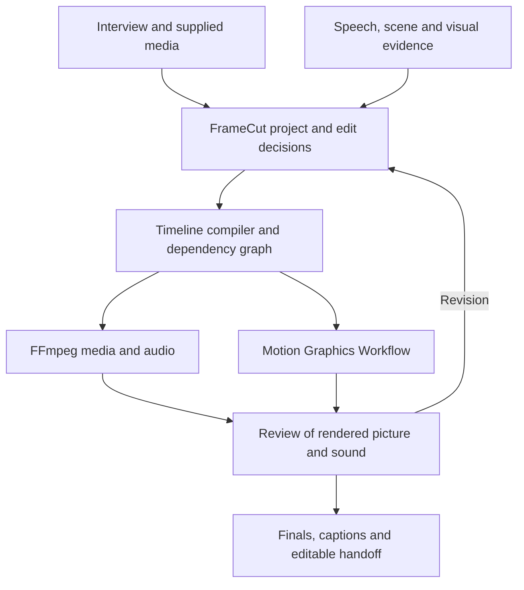

# FrameCut foundation

Status: implementation proposal, 2026-10-20. Product scope is owner-directed; architecture choices below are recommendations. This documentation does not register a new mode, install dependencies or claim a working FrameCut render pipeline.

Baseline: Studio 1.112.0, source commit 45cab60d12f98663ce17fdc08cc753d5bfeef1cd. The existing saved Work package has supplemental integrations that are not public source. Preserve that overlay when implementation eventually changes the shared package.

## Read in this order

1. [Research and component decisions](research.md): what to reuse, evaluate, defer or exclude, with primary sources.
2. [Data and timing contracts](contracts.md): one editable project, source provenance, timeline semantics and revision behavior.
3. [Implementation and acceptance](implementation.md): exact owners, repository touchpoints, test cases and release gates.
4. [Source snapshot](research-sources-2026-10-20.json): 31 repository observations, commit pins, license metadata, evidence depth and decisions. Pins identify researched source, not approved installation versions.

## Product contract

FrameCut is a selectable Studio mode for taking a video job from an adaptive interview through material analysis, editorial planning, editing, motion, sound, review and delivery. It covers supplied footage, generated assets, mixed productions and motion-only work. A talking-head recording converted into highlights is an acceptance example, not the definition of the product.

The owner requested the name FrameCut and a separate option in the full welcome. The proposed menu label is simply **FrameCut**, with a localized description such as “Analyze, edit and finish your video.” In Polish: “Analiza, montaż i gotowe wideo.” The complete welcome, existing options and language selection remain governed by workflow-orchestrator. Add the option only with its working route and tests; do not advertise unsupported execution.

The interview fills only consequential gaps: desired outcome, intended viewer and viewing context, supplied materials and rights, required output variants, style/references, protected content, deadline/resources and delegated decision scope. Reuse information already supplied. First inspect basic media metadata when files are available, so the user is not asked to provide durations and dimensions the tools can read. For an open brief, recommend a scoped approach and identify assumptions. For a complete request, proceed within that authorization. Neither a fixed questionnaire nor approval of every individual cut is required.

The same mode supports full edits, cleanup, highlights, compilations, explanations, product sequences, screen recordings and repairs. Generated additions are derived from the brief and source evidence; generation costs and external transfers follow existing authorization. No library of mandatory creative formulas or category-specific scenarios is introduced.

## Architecture decisions

| ID | Decision | Reason and change trigger |
| --- | --- | --- |
| FC-01 | Extend the existing technical owner opencut-video-studio; expose FrameCut as the product name and welcome route | Avoid a second edit owner and extra discovery budget. Keep the existing skill ID, paths and OpenCut handoff. Reconsider only if measured routing tests cannot distinguish ownership. |
| FC-02 | Introduce one versioned FrameCut project with exact timeline placement and source mappings | Captions, music, overlays and variants must survive cuts and revisions together. An editor-specific export cannot preserve all authoring intent. |
| FC-03 | Reuse FFmpeg/FFprobe for media execution and HyperFrames through Motion Graphics Workflow for coded motion | These already fit Studio. Rendering adapters receive validated data; the model does not supply arbitrary executable filtergraphs. |
| FC-04 | Run a bounded Kinocut adapter comparison before implementing a large execution layer | Its typed timeline and workflow code are promising. Adopt a narrow adapter only if it passes the same timing, revision, host and resource tests as the native route. Avoid importing its entire product or tool surface. |
| FC-05 | Keep ASR, alignment, diarization and visual analysis replaceable | Existing PyWhisperCpp is the first reuse candidate. Benchmark faster-whisper and WhisperX where they add measured quality. A tiny model being installed does not establish transcript quality. |
| FC-06 | Keep semantic editorial decisions in Studio, grounded in inspectable media evidence | VAD, scene detection, topic segmentation and punctuation are candidate signals. None proves that a cut preserves meaning or makes a strong standalone clip. |
| FC-07 | Use OTIO as an interchange adapter, with explicit conversion losses | Do not make a new hand-written OTIO parser the foundation. Preserve the legacy simple exporter and add official-library validation for richer interchange. |
| FC-08 | Keep the minimal workflow local to the host execution environment | No mandatory paid provider, external footage upload, GPU, desktop NLE or MCP registration. Optional routes declare their actual requirements. “Local” means the current execution host, not necessarily the user's personal computer. |
| FC-09 | Preserve installed working tools; gate new dependencies through the existing inventory process | First-install/update checks retain the 59-component inventory. A FrameCut job checks its selected capabilities, not a second unrelated installer. |

## Responsibilities and flow

The diagram describes the proposed architecture, not installed functionality. FrameCut owns project decisions and the common timeline. Existing specialists own their craft: Caption Studio owns typography and caption checks; Motion Graphics Workflow owns compositions and motion quality; Audio Production Director owns sound treatment; output review owns final evaluation; Asset Manifest owns media identity and rights notes. Subordinate tools return evidence and artifacts instead of inventing a competing master timeline.

| Stage | Durable result | Completion condition |
| --- | --- | --- |
| Intake | Brief, deliverable list, locks and delegated decisions | The intended result is clear enough to make the next editorial decision |
| Ingest | Asset records, stream probes, source hashes, analysis proxies | Sources decode, their clocks are known, originals remain unchanged |
| Understand | Transcript, shots, speech activity, visual/OCR observations and uncertainty | Every used observation points to a source interval; missing analysis is visible |
| Decide | Candidate moments, sequence plan, exclusions with reasons | Standalone meaning, evidence and diversity assessed against the brief |
| Assemble | Source-to-timeline mapping and revisioned project | Timing, dependencies, handles and protected regions validate |
| Finish | Captions, motion compositions, framing, color and sound | All layers are derived from the current project revision |
| Review | Technical checks plus actual visual/audio review evidence | No critical defect; quality meets the brief, or remaining limitations are explicit |
| Deliver | Final media, optional sidecars/editor exports, project and receipt | Files exist, are playable and correspond to the approved revision |

## Existing building blocks and actual gaps

Paths below are relative to plugins/framecore-work-creative-studio. The inspection proves source behavior and ownership, not a fresh host execution result.

| Current component | Input and output | Reuse and missing connection |
| --- | --- | --- |
| skills/opencut-video-studio/SKILL.md | Brief/assets to Edit Pack | Currently a planning/handoff bridge. Add FrameCut execution coordination here. |
| skills/opencut-video-studio/scripts/edit_export.py | Simple edit JSON to EDL, OTIO JSON and CSV | One video track, cuts/gaps and nominal non-drop-frame timecodes. No general layered timeline, transitions or semantic assembly. Preserve compatibility and declare export scope. |
| skills/caption-studio/assets/captions/captions.py | Words/segments/subtitles to checked SRT/VTT, motion caption data or burn-in | Reuse formatting and QA. Add a source-aware retiming adapter before it; do not retime already-retimed captions. |
| skills/hyperframes-workflow/references/motion-contract-json.md | Revisioned motion score to approved composition | Already has rational FPS, half-open scene intervals, locks and approval evidence. Embed/refer to local composition contracts; do not create a second global motion clock. |
| skills/hyperframes-workflow/assets/motion-sound/footage.py | Footage to scene/cut observations | Evidence input, not semantic highlight selection. |
| skills/hyperframes-workflow/assets/motion-sound/sound.py | Sound design instructions to soundtrack artifacts | Reuse audio design; connect placements to timeline events. |
| skills/hyperframes-workflow/assets/sound-listen/listen.py and place_sfx.py | Audio/picture timing to analysis and placed effects | Reuse measurement and sync checks; reports do not substitute for listening. |
| skills/hyperframes-workflow/assets/motion-sync/audio_envelope.py, beats.py, lyric_timing.py | Audio/lyrics to timed motion evidence | Reuse beat/word anchors after mapping source time to sequence time. |
| skills/hyperframes-workflow/assets/animate-voice/retime.py | Animate voice output to language-aware word timing | Specific voice workflow, not a universal footage ASR contract. |
| skills/output-critic-iteration/scripts/image_probe.py; motion_activity and craft/contrast helpers | Frames/video to limited visual checks | Reuse as QA signals, not a claim that the whole film has been watched. |
| skills/workflow-orchestrator/assets/environment-check/runtime-tools.json and audit_tools.py | Host probes to tool status and installation plan | Existing 59-component baseline. Keep observed versions separate from desired versions and installation from capability. |
| Hosted supplemental media/motion/engine adapters | Local ASR, media analysis, rendering and cleanup capabilities | Use via declared interfaces and actual capability checks. Their private source is not copied into the public repository by this research. |

The extension registry also contains REA, Animate, OpenCreator and earshot. REA is software reverse-engineering support, not a rough-cut engine. OpenCreator is an optional external workspace; earshot can add sound-model analysis; Animate is an existing motion route. None should become a mandatory FrameCut dependency merely because it is registered.

## Host and installation model

The public contract must work without hosted-only source. Either implement a small public adapter from documented APIs or consume an optional installed provider through an explicitly versioned interface. Never hardcode a private overlay path as the only way the public module runs.

| Host capability observed in the current session | Permitted outcome |
| --- | --- |
| No execution | Interview, analysis supported by host-visible media, plan and handoff. State that no video was rendered. |
| Python plus FFmpeg, no browser | Ingest, supported local analysis, edits, audio, basic captions and exports |
| Python, FFmpeg, Node and working headless browser | Full footage plus coded-motion path, subject to codec/font/render probes |
| Optional GPU/model runtimes | Faster or richer analysis only after capability and model checks |
| Desktop NLE/MCP actually connected | Optional editable handoff or editor operations with a tested adapter |

Do not infer capabilities from “ChatGPT”, “Claude” or “Codex” alone. Work, ordinary chat, desktop and CLI sessions have different execution and network access. This research did not run FrameCut in any of them.

At first install and updates, use the existing full inventory, report present/missing/broken/unknown components, announce concrete planned installations before running them, and verify afterward. Do not force the owner's exact versions onto a functioning compatible host. A dependency introduced by an accepted FrameCut adapter needs its package identity, platform recipe, version policy, model provenance, size estimate, probe and failure behavior added to the catalog. A research candidate is not an installation promise.

Separate Python environments where requirements conflict, including existing Manim and bpy runtimes. Lock transitive packages, model revisions and browser builds per supported platform after a successful pilot. Keep ffmpeg and ffprobe compatible; imageio's bundled FFmpeg alone does not establish FFprobe, codec, libass or filter availability. New Chromium builds and ASR downloads are declared installation actions, not hidden side effects of a render.

## Decisions still requiring evidence

No user decision is needed to finish this foundation. Before implementation promotes an adapter, resolve: Kinocut versus a narrow native executor; Polish word-timing accuracy of the installed ASR route; CPU/RAM/disk budgets on the supported hosts; mixed-frame-rate and VFR behavior; transparent motion compositing; OTIO imports in named editor versions; optional model licenses/download terms; and actual startup routing in ordinary ChatGPT as well as Work. These are engineering gates, not reasons to repeatedly ask the user to choose technical libraries.

Recheck external claims when the selected commit/package/model changes, an upstream license changes, a host changes, or a failing test contradicts the documented behavior. Retain this snapshot as historical evidence.
